# NexusFlows — High-Level Design (HLD)

This document is written for **system design interviews**: use it to explain *what* NexusFlows is, *how* requests and jobs flow, and *why* key technologies were chosen.

**Companion:** [README.md](../README.md) (setup, env vars, node catalog).

---

## 1. Problem statement

Build a **multi-tenant workflow automation SaaS** where:

- Users design **directed acyclic graphs** (workflows) in a browser.
- Runs are **durable** (survive restarts, retry failed steps).
- Steps can call **external APIs** and **LLMs** using stored credentials.
- Users see **live progress** during a run and **history** afterward.

Non-goals in the current codebase: horizontal sharding, per-tenant isolated workers, signed webhook verification (extension point).

---

## 2. System context (C4 Level 1)

Who interacts with the system and what external systems are involved.

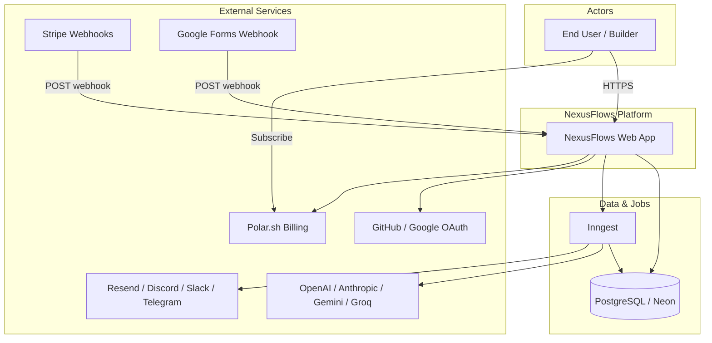

**One-liner for interviews:**  
*“The Next.js app is the control plane and API gateway; PostgreSQL is the source of truth for graphs and executions; Inngest is the data plane for running workflows and calling third parties.”*

---

## 3. Container diagram (C4 Level 2)

Major deployable / logical containers inside the platform.

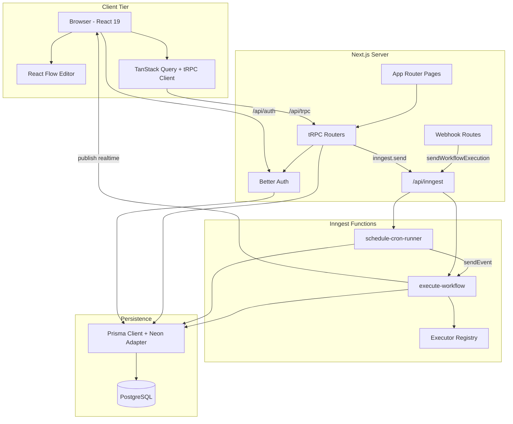

---

## 4. Component diagram — workflow domain

Feature modules and how they connect.

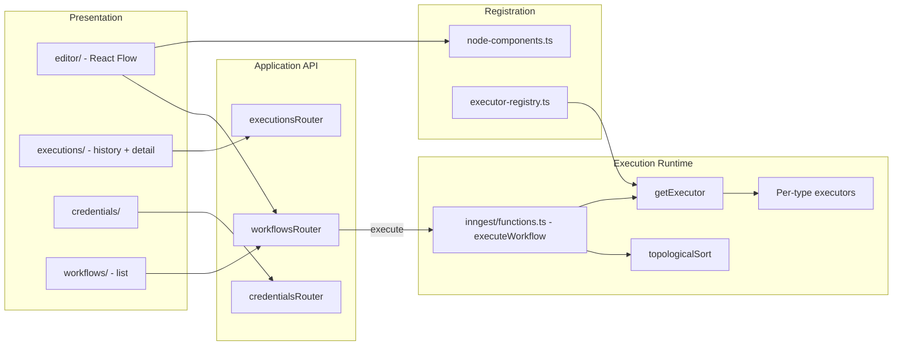

**Design pattern:** *Plugin-style node types* — UI component map and executor map keyed by the same `NodeType` enum from Prisma.

---

## 5. Core data model (ER)

```mermaid
erDiagram
    User ||--o{ Workflow : owns
    User ||--o{ Credential : owns
    User ||--o{ Session : has
    User ||--o{ Account : has

    Workflow ||--o{ Node : contains
    Workflow ||--o{ Connection : contains
    Workflow ||--o{ Execution : runs

    Node ||--o{ Connection : from
    Node ||--o{ Connection : to
    Credential ||--o{ Node : optional

    User {
        string id PK
        string email UK
        datetime trialEndsAt
    }

    Workflow {
        string id PK
        string userId FK
        string name
    }

    Node {
        string id PK
        string workflowId FK
        enum type
        json position
        json data
        string credentialId FK
    }

    Connection {
        string id PK
        string fromNodeId FK
        string toNodeId FK
        string fromOutput
        string toInput
    }

    Execution {
        string id PK
        string workflowId FK
        enum status
        string inngestEventId UK
        json output
    }

    Credential {
        string id PK
        string userId FK
        enum type
        string value
    }
```

**Graph semantics:**

- **Nodes** = steps; **Connections** = edges with optional handles (`fromOutput` / `toInput`) for branching.
- **Workflow** save = transaction: delete old nodes, recreate nodes + connections from React Flow state.

---

## 6. Sequence — manual workflow execution

Typical path when the user clicks **Execute** in the editor.

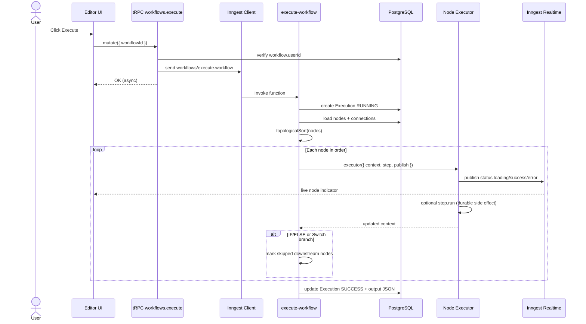

---

## 7. Sequence — scheduled execution

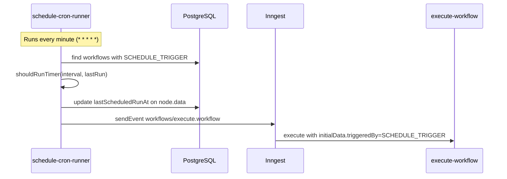

**Idempotency:** Schedule uses deterministic `eventId` from `getScheduleEventId` to reduce duplicate fires for the same tick.

---

## 8. Sequence — webhook-triggered execution

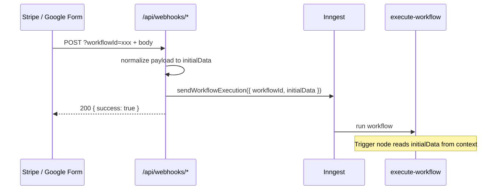

Webhook URLs are shown in trigger node dialogs using `NEXT_PUBLIC_APP_URL`.

---

## 9. Execution engine — internal flow

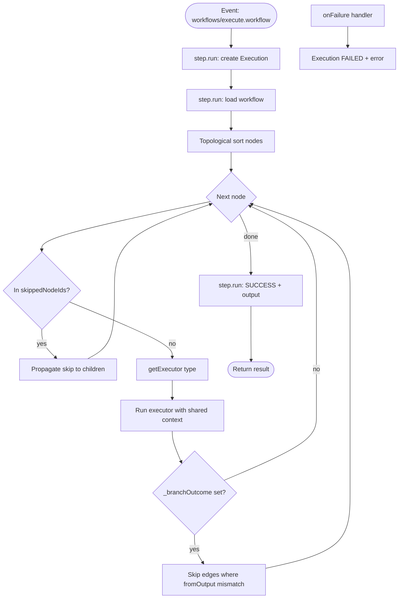

**Shared context:** A plain JSON object passed through the DAG. Nodes typically write under a user-defined variable name, e.g. `{ "httpResult": { "status": 200, "body": "..." } }`.

**Templating:** Many executors compile config strings with Handlebars against `context`.

---

## 10. Branching model (IF/ELSE & Switch)

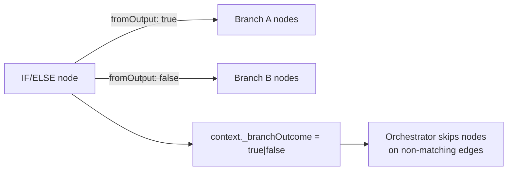

- Connection **`fromOutput`** must match **`context._branchOutcome`** for the target node to run.
- Skipped nodes recursively skip their descendants (for nodes that were only reachable through a losing branch).

---

## 11. Realtime updates (Inngest Realtime)

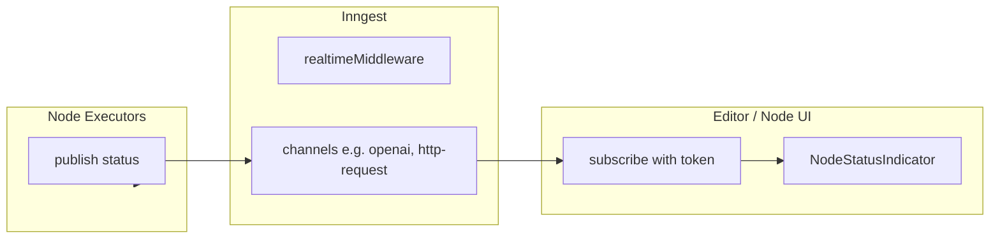

Each heavy node type can define a channel under `src/inngest/channels/`. Executors call `publish` at start, success, and error so the canvas reflects run state without polling execution rows.

---

## 12. Authentication & authorization

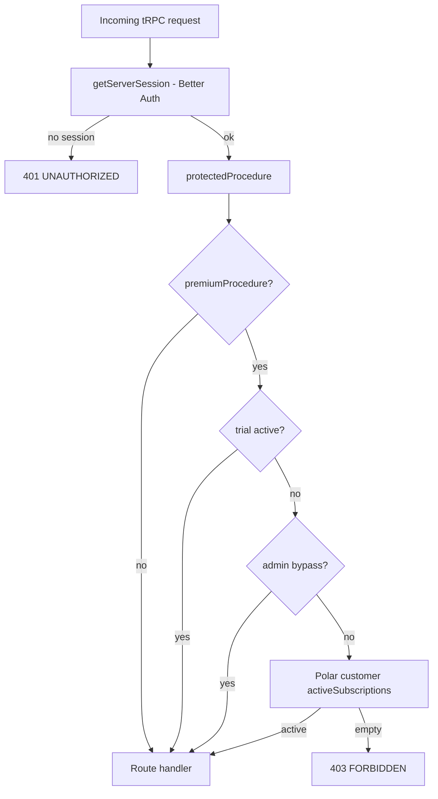

---

## 13. Deployment view (typical production)

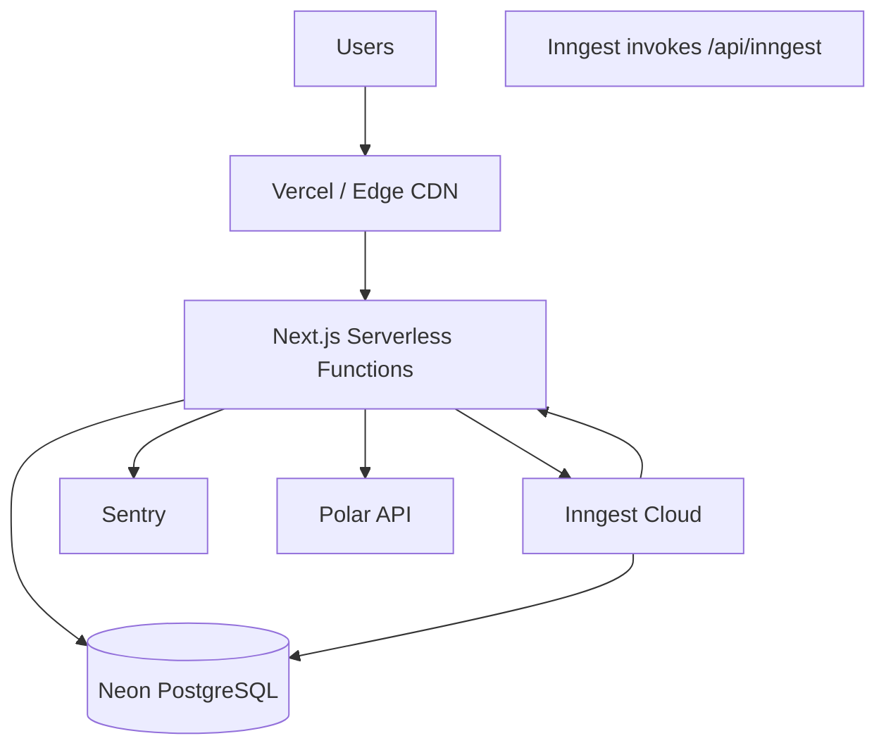

**Local dev:** `mprocs` runs Next on `:3000` and Inngest Dev Server pointing at `http://127.0.0.1:3000/api/inngest`.

**Production Inngest client:** `NODE_ENV=production` forces cloud mode; set `INNGEST_EVENT_KEY` and `INNGEST_SIGNING_KEY`.

---

## 14. Key design decisions (interview cheat sheet)

| Decision | Choice | Rationale |
|----------|--------|-----------|
| Workflow storage | Relational graph (Node + Connection) | Easy queries, FK integrity, matches editor model |
| Run orchestration | Inngest function + `step.run` | Retries, durability, concurrency control, no self-managed queue |
| Order of execution | Topological sort | Respects dependencies; detects cycles |
| Node extensibility | Registry pattern | Add type in one enum + two registrations |
| API to frontend | tRPC + SuperJSON | End-to-end types, efficient mutations for graph saves |
| DB in serverless | Prisma Neon adapter | Connection pooling / serverless driver |
| Secrets | Encrypted credentials table | Keys not in workflow JSON; linked by `credentialId` |
| Monetization | Polar + trial field on User | Server-side gate on premium mutations |
| Live UX | Inngest Realtime | Push node status to editor during long steps |

---

## 15. Scalability & reliability (talking points)

**What scales easily today**

- **Stateless Next.js** instances behind a load balancer.
- **Inngest** scales workers; concurrency limit per workflow prevents overlapping runs on the same graph.
- **Neon** scales storage and compute independently.

**Current bottlenecks / future work**

- **Sequential node loop** in one function — very large workflows increase single-run duration (could shard into sub-functions per node).
- **Cron scanner** loads all scheduled workflows every minute — would move to per-workflow cron or Inngest schedules at scale.
- **Webhook security** — add HMAC verification and workflow-specific secrets.
- **JavaScript node** — stronger isolation (worker process, WASM, or disallow in multi-tenant SaaS).

---

## 16. Failure handling

| Scenario | Behavior |
|----------|----------|
| Executor throws | Inngest retries (3× in production); `onFailure` marks `Execution` `FAILED` with message/stack |
| `NonRetriableError` | No retry (e.g. misconfigured node) |
| Cycle in graph | Topological sort throws before run |
| Missing executor | Hard error at runtime for unknown `NodeType` |
| DB unavailable | Request fails; Inngest may retry the step |

---

## 17. Suggested 2-minute interview pitch

> “NexusFlows is a workflow automation product built on Next.js and PostgreSQL. Users edit a visual DAG in React Flow; we persist nodes and edges in Postgres. When a workflow runs—manually, on a schedule, or via webhooks—we enqueue an Inngest event. A single orchestrator function topologically sorts the graph, runs a typed executor per node, and passes a JSON context forward. Branching nodes set a branch outcome and we skip downstream paths on losing edges. Side effects like LLM calls run inside Inngest steps for durability, and we push live status to the UI with Inngest Realtime. Credentials are encrypted at rest, auth is Better Auth, and premium features are gated with Polar subscriptions after a trial.”

---

## 18. File reference (implementation map)

| Concern | Primary files |
|---------|----------------|
| Orchestrator | `src/inngest/functions.ts` |
| Schedule | `src/inngest/cron-runner.ts` |
| Executors | `src/features/executions/lib/executor-registry.ts` |
| Sort / enqueue | `src/inngest/utils.ts` |
| tRPC entry | `src/trpc/routers/_app.ts` |
| Schema | `prisma/schema.prisma` |
| Inngest HTTP | `src/app/api/inngest/route.ts` |
| Editor | `src/features/editor/components/editor.tsx` |
